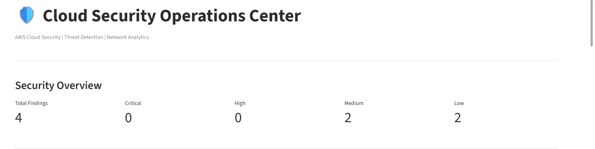
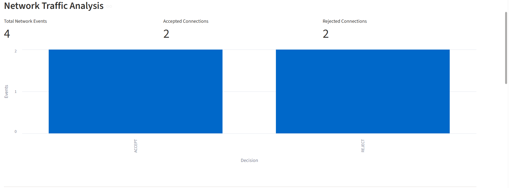
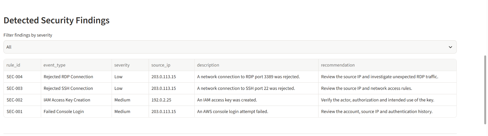
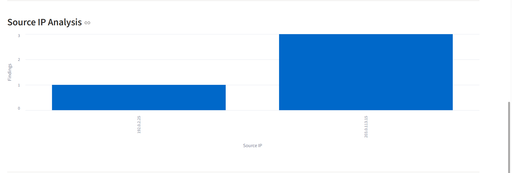
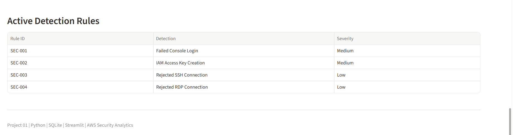

# AWS Cloud Security Threat Detection

**Python | Cloud Security | Threat Detection | DevSecOps | Docker | GitHub Actions**

[](https://github.com/Emmatos/cloud-security-threat-detection/actions)

## Project Overview

AWS Cloud Security Threat Detection is a Python-based security monitoring and log analysis application designed to identify potentially suspicious activities from simulated AWS CloudTrail events and VPC Flow Logs.

The project demonstrates how security event ingestion, rule-based threat detection, database persistence, dashboard visualization, containerization and automated security testing can work together in a practical cloud security workflow.

The application uses synthetic security events and runs locally through Streamlit and Docker. It is an AWS-inspired security monitoring simulation, not a live AWS deployment.

## Project Objectives

- Analyse simulated AWS CloudTrail events.
- Process VPC Flow Logs and identify rejected network connections.
- Implement rule-based security detection.
- Store security findings in SQLite.
- Visualize security events through a Streamlit dashboard.
- Containerize the application using Docker.
- Preserve application data using Docker named volumes.
- Automate code quality, security scanning, testing and Docker builds through GitHub Actions.

## Architecture

The application follows this workflow:

1. Synthetic CloudTrail and VPC Flow Logs provide security event data.
2. The ingestion module reads and parses the event files.
3. The detection engine evaluates events against defined security rules.
4. Detected findings are stored in SQLite.
5. Streamlit displays security findings and network traffic analytics.
6. Docker packages the application for consistent execution.
7. GitHub Actions automatically validates code quality, security and application functionality.

### Technology Stack

| Component | Technology |
|---|---|
| Programming language | Python 3.12 |
| Dashboard | Streamlit |
| Data processing | Pandas |
| Database | SQLite |
| Containerization | Docker |
| CI/CD | GitHub Actions |
| Code quality | Ruff |
| Python security scanning | Bandit |
| Dependency auditing | pip-audit |
| Automated testing | Pytest |
| Version control | Git and GitHub |

## Security Detection Rules

The detection engine currently implements four rules.

| Rule ID | Detection | Severity |
|---|---|---|
| SEC-001 | Failed AWS Console Login | Medium |
| SEC-002 | IAM Access Key Creation | Medium |
| SEC-003 | Rejected SSH Connection (Port 22) | Low |
| SEC-004 | Rejected RDP Connection (Port 3389) | Low |

These rules identify events requiring investigation. A detection does not automatically establish that an attack has occurred.

## Dashboard Features

The Streamlit Security Operations Center provides:

- Total security findings.
- Critical, High, Medium and Low severity metrics.
- Accepted and rejected network traffic statistics.
- Network traffic visualization.
- Security findings table with severity filtering.
- Source IP analysis.
- Active detection rules.

### Sample Dashboard Results

The current synthetic dataset produces:

| Metric | Result |
|---|---:|
| Total security findings | 4 |
| Critical findings | 0 |
| High findings | 0 |
| Medium findings | 2 |
| Low findings | 2 |
| Total network events | 4 |
| Accepted connections | 2 |
| Rejected connections | 2 |

These are sample project results, not live AWS telemetry.


## Cloud Security Operations Center — Dashboard Screenshots

The following screenshots demonstrate the application's security monitoring and analytics capabilities using simulated AWS CloudTrail events and VPC Flow Logs.

### 1. Security Overview

Displays the total security findings and their severity distribution.



### 2. Network Traffic Analysis

Visualizes accepted and rejected network connections from simulated VPC Flow Logs.



### 3. Detected Security Findings

Displays detected security events, severity levels, source IP addresses, descriptions, and recommended investigation actions.



### 4. Source IP Analysis

Visualizes the distribution of security findings across source IP addresses.



### 5. Active Detection Rules

Shows the four implemented detection rules and their associated severity levels.




## Repository Structure

```text
cloud-security-threat-detection/
│
├── .github/
│   └── workflows/
│       └── ci-cd.yml
│
├── dashboard/
│   └── app.py
│
├── data/
│   ├── cloudtrail/
│   │   └── sample_cloudtrail.json
│   └── vpc-flow-logs/
│       └── sample_vpc_flow.log
│
├── database/
│   └── security_findings.db
│
├── src/
│   ├── __init__.py
│   ├── detection_engine.py
│   ├── ingestion.py
│   └── storage.py
│
├── tests/
│   ├── test_detection_engine.py
│   ├── test_project.py
│   └── test_storage.py
│
├── .dockerignore
├── .gitignore
├── Dockerfile
├── README.md
├── requirements.txt
└── requirements-dev.txt
```

The local SQLite database is generated by the application and excluded from Git tracking.

## Installation and Local Execution

### Prerequisites

- Python 3.12
- Git
- Visual Studio Code (recommended)

### 1. Clone the repository

```bash
git clone https://github.com/Emmatos/cloud-security-threat-detection.git
cd cloud-security-threat-detection
```

### 2. Create a virtual environment

```bash
python -m venv .venv
```

Activate it on Windows PowerShell:

```powershell
.\.venv\Scripts\Activate.ps1
```

### 3. Install dependencies

```bash
python -m pip install -r requirements.txt
```

Install development and security tools:

```bash
python -m pip install -r requirements-dev.txt
```

### 4. Run the detection engine

```bash
python -m src.detection_engine
```

### 5. Launch the dashboard

```bash
python -m streamlit run dashboard/app.py
```

Open:

http://localhost:8501

## Docker Deployment

Build the Docker image:

```bash
docker build -t cloud-security-threat-detection:v2 .
```

Create a persistent Docker volume:

```bash
docker volume create cloud-security-db
```

Run the application:

```bash
docker run -d \
  --name cloud-security-dashboard \
  -p 8502:8501 \
  -v cloud-security-db:/app/database \
  cloud-security-threat-detection:v2
```

On Windows PowerShell, the same command can be written on one line:

```powershell
docker run -d --name cloud-security-dashboard -p 8502:8501 -v cloud-security-db:/app/database cloud-security-threat-detection:v2
```

Open:

http://localhost:8502

### Docker Health Monitoring

The Dockerfile includes a HEALTHCHECK that monitors the Streamlit application health endpoint.

Check container status:

```bash
docker ps
```

### Database Persistence

The application uses a Docker named volume to separate persistent SQLite storage from the container lifecycle.

The project was tested by stopping and removing the original container, recreating it and reconnecting the existing volume.

The database retained all four security findings after recreation.

Note: Docker volumes provide persistent storage but are not a substitute for independent backups.

## DevSecOps and CI/CD Pipeline

GitHub Actions automates the project's validation process on pushes and pull requests targeting the `main` branch.

### Automated Pipeline Stages

1. Checkout repository.
2. Configure Python 3.12.
3. Install application dependencies.
4. Install development and security tools.
5. Run Ruff code-quality checks.
6. Run Bandit Python security scanning.
7. Run pip-audit dependency vulnerability checks.
8. Execute automated Pytest tests.
9. Build the Docker image.

### Security and Quality Validation

| Tool | Purpose |
|---|---|
| Ruff | Python code quality and import validation |
| Bandit | Static analysis for common Python security issues |
| pip-audit | Known vulnerability auditing of Python dependencies |
| Pytest | Automated functional and database testing |
| Docker | Container image build validation |

### Latest Verified Results

- Ruff: All checks passed.
- Pytest: 10 tests passed.
- Bandit: No issues identified in the scanned source.
- pip-audit: No known vulnerabilities found at the time of the audit.
- GitHub Actions: Successful pipeline execution.
- Docker: Image build completed successfully.

These results apply to the versions and source code scanned at the time of execution; they are not a guarantee of vulnerability-free software.

## Security Considerations and Limitations

- Uses synthetic CloudTrail and VPC Flow Log data.
- Does not connect to a live AWS account.
- Detection is rule-based, not machine-learning-based.
- Alerts represent investigation leads, not confirmed security incidents.
- The current application does not provide automated incident response.
- Network traffic analytics are read directly from the sample VPC Flow Log file, while security findings are stored in SQLite.
- Production deployment would require additional authentication, authorization, encryption, secure secret management, monitoring, backup and recovery controls.

## Future Improvements

- Integrate live AWS CloudTrail ingestion.
- Integrate Amazon GuardDuty and Security Hub.
- Add AWS CloudWatch alerting.
- Introduce additional detection rules.
- Add event deduplication and detection history management.
- Implement role-based access control.
- Introduce container image scanning and secrets detection.
- Add infrastructure-as-code security scanning.
- Explore AI-assisted security alert analysis with human approval.

## Professional Skills Demonstrated

This project demonstrates practical experience in:

- Python programming and automation.
- Cloud security monitoring concepts.
- Security log ingestion and analysis.
- Rule-based threat detection.
- SQLite database integration.
- Streamlit dashboard development.
- Docker containerization and health monitoring.
- Persistent container storage.
- Git and GitHub version control.
- GitHub Actions CI/CD.
- DevSecOps security scanning.
- Automated testing and technical documentation.

## Project Repository

**GitHub:** https://github.com/Emmatos/cloud-security-threat-detection

**LinkedIn:** https://www.linkedin.com/in/pharm-emma-obidike/

## Author

**Emmanuel T. Obidike**

Cloud Security | DevOps | DevSecOps | Healthcare Technology

This project is part of my practical cloud security and DevSecOps engineering portfolio.

*Building secure, testable and maintainable applications through practical engineering.*
